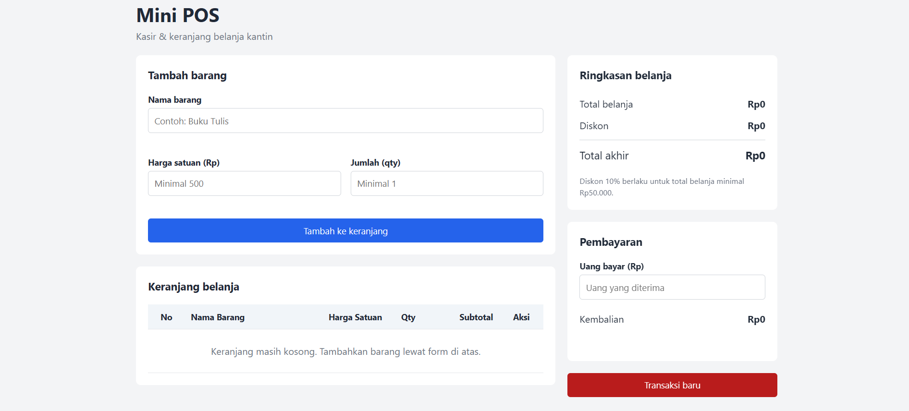
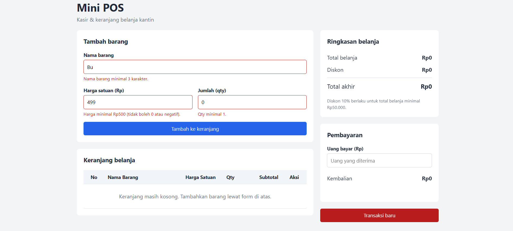
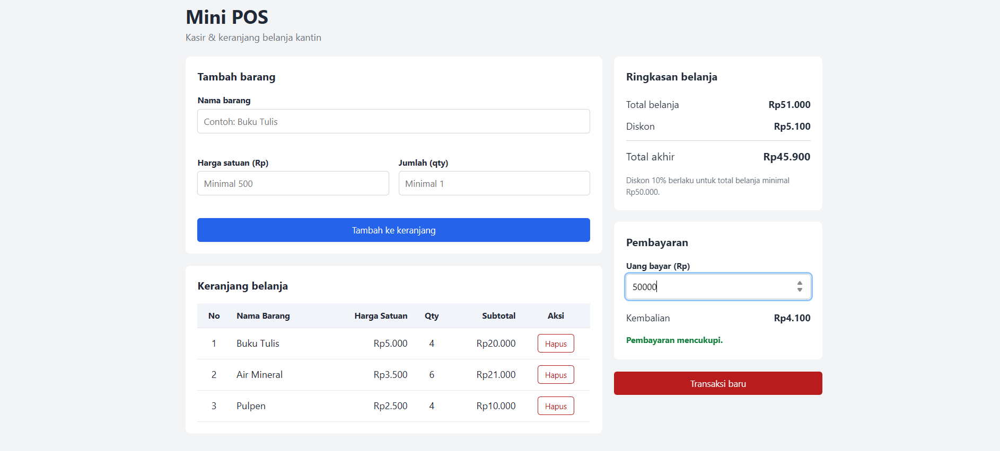

# Aplikasi Kasir & Keranjang Belanja Sederhana (Mini POS)

## Identitas

- **Nama Lengkap:** Jundi Lamtara
- **NIM:** 124140190
- **Program Studi:** Teknik Informatika
- **Kelas Praktikum:** Pengembangan Aplikasi Web RB
- **Repository GitHub:** [Source Code Pertemuan 1](https://github.com/Jey-EL/pemrograman_web_itera_124140190/tree/main/JundiLamtara_124140190_pertemuan1)
- **GitHub Pages:** [Mini POS - Kasir & Keranjang Belanja](https://jey-el.github.io/pemrograman_web_itera_124140190/pertemuan1/tugas_kasir_mini_pos/)

## Deskripsi Aplikasi

Aplikasi **Kasir & Keranjang Belanja Sederhana (Mini POS)** merupakan aplikasi berbasis web yang dirancang untuk membantu operasional kasir kantin atau toko kampus dalam mencatat transaksi penjualan secara cepat dan akurat. Aplikasi ini menggabungkan validasi input barang, perhitungan subtotal dan total belanja otomatis, penerapan diskon transaksi, kalkulasi uang kembalian, serta penyimpanan data keranjang secara persisten menggunakan `localStorage`.

## Struktur Berkas

```text
JundiLamtara_124140190_pertemuan1/
│
├── hands-on/
│   ├── 1_Variabel-Kondisional/
│   ├── 2_Loop-Fungsi/
│   ├── 3_Array-Objek/
│   └── 4_DOM-API/
│
├── latihan/
│   ├── 1_Variabel-Kondisional/
│   ├── 2_Loop-Fungsi/
│   ├── 3_Array-Objek/
│   └── 4_DOM-API/
│
├── screenshot/
│   ├── 01-form-utama.png
│   ├── 02-validasi-error.png
│   └── 03-hasil-perhitungan.png
│
├── tugas_kasir_mini_pos/
│   ├── index.html
│   ├── script.js
│   └── style.css
│
└── README.md
```

## Panduan Menjalankan Aplikasi

1. Clone atau unduh repository ini ke komputer lokal:
   ```bash
   git clone https://github.com/Jey-EL/pemrograman_web_itera_124140190.git
   ```
2. Masuk ke direktori `JundiLamtara_124140190_pertemuan1/tugas_kasir_mini_pos`.
3. Buka file `index.html` menggunakan ekstensi **Live Server** di Visual Studio Code atau buka langsung melalui browser (Google Chrome / Microsoft Edge).

## Daftar Fitur

- [x] **Validasi Form Input Barang:** Memeriksa nama barang (minimal 3 karakter), harga satuan (bilangan bulat positif minimal Rp500), dan jumlah/qty (bilangan bulat minimal 1) disertai pesan error berwarna merah serta reset form otomatis saat valid.
- [x] **Kalkulasi Subtotal & Total Belanja Otomatis:** Menghitung `Subtotal = Harga Satuan × Qty` pada setiap baris barang dan mengakumulasikan total belanja secara *real-time*.
- [x] **Kalkulator Diskon Otomatis:** Memberikan potongan diskon 10% secara otomatis saat total belanja mencapai minimal Rp50.000 dan menampilkan nominal potongan beserta total akhir.
- [x] **Kalkulator Pembayaran & Kembalian:** Menghitung selisih `Kembalian = Uang Bayar − Total Akhir` secara otomatis dan menampilkan status keterangan apabila nominal uang bayar belum mencukupi.
- [x] **Manajemen Tabel Keranjang Belanja:** Menampilkan daftar belanja interaktif (No, Nama Barang, Harga Satuan, Qty, Subtotal, dan Aksi) dengan tombol **Hapus** di setiap baris.
- [x] **Penyimpanan Persisten (`localStorage`):** Menyimpan data keranjang menggunakan `JSON.stringify()` dan memuatnya kembali menggunakan `JSON.parse()` sehingga data tetap tersimpan meskipun halaman di-refresh.
- [x] **Tombol Transaksi Baru / Reset:** Mengosongkan seluruh daftar keranjang belanja sekaligus menghapus data dari `localStorage` untuk memulai transaksi baru.

## Penjelasan Teknis Singkat

1. **Penanganan Validasi Input:** Ketika form disubmit (`event.preventDefault()`), fungsi `validasiForm()` memeriksa panjang karakter nama barang (`nama.length >= 3`), nilai numerik bilangan bulat harga (`Number.isInteger(harga) && harga >= 500`), serta bilangan bulat kuantitas (`Number.isInteger(jumlah) && jumlah >= 1`). Jika salah satu syarat tidak terpenuhi, teks pesan kesalahan ditampilkan pada elemen `<small>` di bawah masing-masing kolom input dan fokus diarahkan ke input yang bermasalah.
2. **Algoritma Kalkulator Transaksi:** Data keranjang disimpan sebagai array of objects. Fungsi `hitungRingkasan()` menjumlahkan seluruh `harga * qty` menggunakan `.forEach()`, mengevaluasi syarat diskon (`total >= 50000`) untuk menghitung potongan 10%, dan menghasilkan `totalAkhir`. Pada event `input` kolom uang bayar, fungsi `hitungKembalian()` membandingkan `uangBayar` dengan `totalAkhir` untuk menampilkan status kurang bayar atau nominal kembalian dalam format Rupiah (`angka.toLocaleString("id-ID")`).
3. **Mekanisme Serialisasi `localStorage`:** Setiap perubahan pada keranjang (tambah item, hapus item, atau reset transaksi) memicu `simpanKeranjang()` yang mengonversi array keranjang menjadi string JSON via `localStorage.setItem("keranjang", JSON.stringify(keranjang))`. Saat halaman dimuat, fungsi `muatKeranjang()` membaca dan memvalidasi kembali data menggunakan `JSON.parse(localStorage.getItem("keranjang"))` sebelum menampilkannya ke tabel melalui `tampilkanKeranjang()`.

## Tangkapan Layar (Screenshot)

### 1. Tampilan Form Input Utama & Keranjang Belanja


### 2. Tampilan Pesan Validasi Error pada Form


### 3. Tampilan Hasil Perhitungan Diskon, Kembalian, dan Tabel Keranjang

