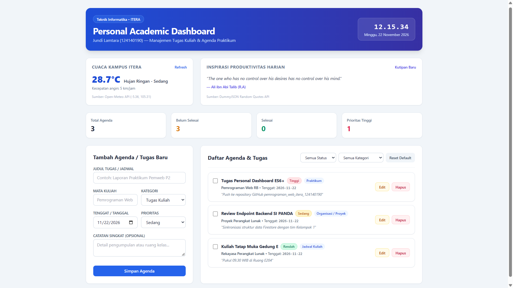

# ITERA Student Personal Dashboard (JavaScript ES6+)

## Identitas

- **Nama Lengkap:** Jundi Lamtara
- **NIM:** 124140190
- **Program Studi:** Teknik Informatika
- **Kelas Praktikum:** Pengembangan Aplikasi Web RB
- **Repository GitHub:** [Source Code Pertemuan 2](https://github.com/Jey-EL/pemrograman_web_itera_124140190/tree/main/JundiLamtara_124140190_pertemuan2)
- **GitHub Pages:** [ITERA Student Personal Dashboard](https://jey-el.github.io/pemrograman_web_itera_124140190/pertemuan2/tugas_personal_dashboard/)

## Deskripsi Aplikasi

Aplikasi **ITERA Student Personal Dashboard** merupakan aplikasi berbasis web interaktif yang dirancang untuk membantu produktivitas mahasiswa Institut Teknologi Sumatera (ITERA) dalam mengelola jadwal kuliah, tenggat tugas, agenda praktikum, serta kegiatan proyek harian dalam satu tampilan terpadu. Aplikasi ini mengimplementasikan arsitektur Object-Oriented modern JavaScript ES6+ (`TaskItem` dan `DashboardApp`), penyimpanan persisten berbasis `localStorage`, serta integrasi data eksternal secara asinkron menggunakan `async/await` untuk menampilkan cuaca kampus ITERA dan kutipan motivasi harian.

## Struktur Berkas

```text
JundiLamtara_124140190_pertemuan2/
│
├── hands-on/
│   ├── 1_Setup-Project/
│   ├── 2_Let-Const-Arrow/
│   ├── 3_Template-Literals/
│   ├── 4_Destructuring-Spread-Rest/
│   ├── 5_Classes-Object-Literals/
│   ├── 6_Modern-Array-Methods/
│   └── 7_Async-Programming/
│
├── latihan/
│   ├── 3_Template-Literals/
│   ├── 4_Destructuring-Spread-Rest/
│   ├── 5_Classes-Object-Literals/
│   ├── 6_Modern-Array-Methods/
│   └── 7_Async-Programming/
│
├── screenshot/
│   └── tugas-personal-dashboard.png
│
├── tugas_personal_dashboard/
│   ├── css/
│   │   └── style.css
│   ├── js/
│   │   ├── main.js
│   │   └── models/
│   │       ├── TaskItem.js
│   │       └── DashboardApp.js
│   └── index.html
│
└── README.md
```

## Panduan Menjalankan Aplikasi

1. Clone atau unduh repository ini ke komputer lokal:
   ```bash
   git clone [https://github.com/Jey-EL/pemrograman_web_itera_124140190.git](https://github.com/Jey-EL/pemrograman_web_itera_124140190.git)
   ```
2. Masuk ke direktori `JundiLamtara_124140190_pertemuan2/tugas_personal_dashboard`.
3. Karena proyek menggunakan **ES6 Modules (`type="module"`)**, buka file `index.html` melalui local HTTP server menggunakan ekstensi **Live Server** di Visual Studio Code.

## Daftar Fitur

- [x] **Manajemen Agenda & Tugas (CRUD Lengkap):** Menambah agenda baru, mengedit detail item (judul, mata kuliah, kategori, tanggal tenggat, prioritas, dan catatan), menandai tugas selesai/belum selesai, serta menghapus item.
- [x] **Penyimpanan Persisten (`localStorage`):** Menyimpan dan memuat ulang daftar agenda secara otomatis menggunakan `JSON.stringify()` dan `JSON.parse()` pada kunci `itera_personal_dashboard_tasks_v1`, dilengkapi tombol **Reset Default**.
- [x] **Filter Multi-Kriteria & Ringkasan Statistik:** Menyaring daftar agenda berdasarkan status penyelesaian (*Semua Status*, *Belum Selesai*, *Selesai*) dan kategori (*Tugas Kuliah*, *Praktikum*, *Jadwal Kuliah*, *Organisasi / Proyek*), disertai kartu statistik *real-time*.
- [x] **Widget Cuaca Kampus ITERA (Open-Meteo API):** Mengambil suhu udara (`°C`), deskripsi kondisi cuaca, dan kecepatan angin (`km/jam`) secara asinkron untuk koordinat kampus ITERA Lampung Selatan (`latitude=-5.36`, `longitude=105.31`).
- [x] **Widget Inspirasi Harian (DummyJSON Quotes API):** Mengambil kutipan motivasi acak secara asinkron yang dapat diperbarui kapan saja melalui tombol **Kutipan Baru**.
- [x] **Jam & Tanggal Digital Real-Time:** Menampilkan waktu lokal Indonesia (WIB) yang diperbarui setiap detik di bagian header dashboard.

## Daftar Fitur ES6+ yang Diimplementasikan

| Fitur ES6+ | Lokasi File & Nomor Baris | Keterangan Implementasi |
| :--- | :--- | :--- |
| **`let` & `const`** | `tugas_personal_dashboard/js/models/DashboardApp.js` (baris 3, 12, 14, 21, 29, 64, 128, 139)<br>`tugas_personal_dashboard/js/main.js` (baris 3–25, 42, 51, 161, 174) | Deklarasi referensi elemen DOM, konstanta kunci `STORAGE_KEY`, endpoint API, dan variabel lokal secara *block-scoped*. |
| **Arrow Functions** | `tugas_personal_dashboard/js/main.js` (baris 28–38, 41–48, 51–70, 73–94, 97–156, 159–171, 174–183)<br>`tugas_personal_dashboard/js/models/DashboardApp.js` (baris 22, 30, 72, 83, 94, 105, 118–121) | Digunakan pada fungsi helper (`describeWeatherCode`, `getPriorityBadgeClass`, `updateClock`), fungsi render DOM, *event listener*, dan callback array methods. |
| **Template Literals** | `tugas_personal_dashboard/js/models/TaskItem.js` (baris 3)<br>`tugas_personal_dashboard/js/main.js` (baris 75–93, 99–104, 108–153, 163–168, 176–179) | Interpolasi variabel `${...}` dan HTML *multi-line* untuk merender kartu statistik, daftar tugas dinamis, widget cuaca, dan kutipan harian. |
| **ES6 Classes & Modules** | `tugas_personal_dashboard/js/models/TaskItem.js` (baris 1–46)<br>`tugas_personal_dashboard/js/models/DashboardApp.js` (baris 5–145)<br>`tugas_personal_dashboard/js/main.js` (baris 1) | Pemisahan arsitektur OOP menggunakan `export class TaskItem` untuk model entitas dan `export class DashboardApp` untuk manajemen state, `localStorage`, serta `fetch()`. |
| **Async / Await & `fetch()`** | `tugas_personal_dashboard/js/models/DashboardApp.js` (baris 127–144)<br>`tugas_personal_dashboard/js/main.js` (baris 159–183) | Method `async fetchIteraWeather()` dan `async fetchDailyQuote()` menggunakan `await` serta penanganan error terstruktur dengan blok `try...catch`. |
| **Destructuring & Default Parameters** | `tugas_personal_dashboard/js/models/TaskItem.js` (baris 2–12, 27–34)<br>`tugas_personal_dashboard/js/main.js` (baris 74, 110, 162, 175, 216) | Ekstraksi properti objek pada parameter konstruktor, callback `.map()`, dataset tombol aksi, dan respons JSON API (`{ temperature, windspeed, weathercode }`, `{ quote, author }`). |
| **Spread Operator (`...`)** | `tugas_personal_dashboard/js/models/DashboardApp.js` (baris 65) | Memperbarui array state `this.tasks = [newTask, ...this.tasks]` secara *immutable* saat menambahkan agenda baru. |

## Penjelasan Teknis Singkat

1. **Arsitektur Modular OOP (`TaskItem` & `DashboardApp`):** Setiap item agenda dienkapsulasi sebagai instance `TaskItem` yang memiliki method `toggleStatus()`, `updateDetails()`, dan `toJSON()`. Seluruh pengelolaan koleksi tugas dipusatkan di `DashboardApp` dengan pendekatan *immutable state* menggunakan spread operator (`[newTask, ...this.tasks]`) dan array methods (`map`, `filter`).
2. **Integrasi Asinkron (`async/await`):** Widget cuaca dan kutipan harian memanggil API publik Open-Meteo dan DummyJSON menggunakan `fetch()` di dalam fungsi `async` dengan blok `try...catch`, disertai indikator status pemuatan dan tombol pembaruan manual.
3. **Sinkronisasi `localStorage`:** Setiap operasi perubahan state memanggil `saveToStorage()` untuk menserialisasi daftar instance `TaskItem` menjadi JSON string dan menyimpannya ke `localStorage`, lalu merekonstruksinya kembali menjadi instance `TaskItem` saat aplikasi dimuat ulang.

## Tangkapan Layar (Screenshot)

### Tampilan Utama ITERA Student Personal Dashboard
