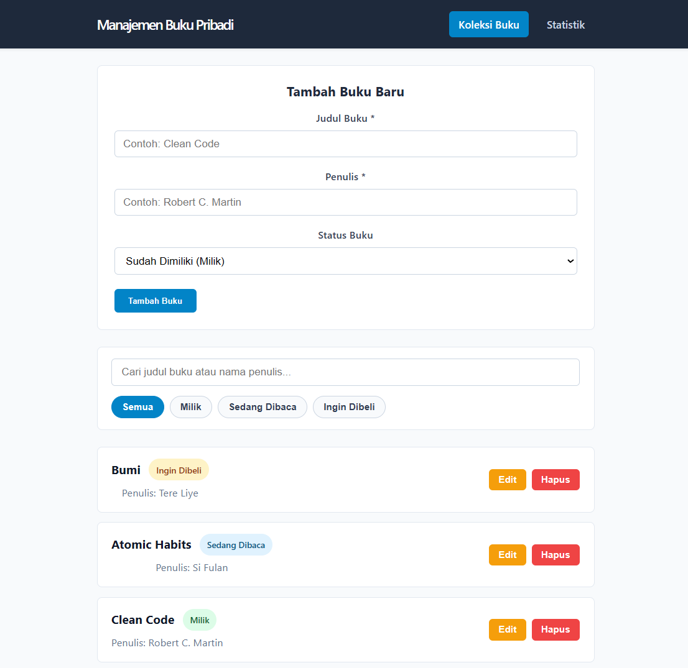
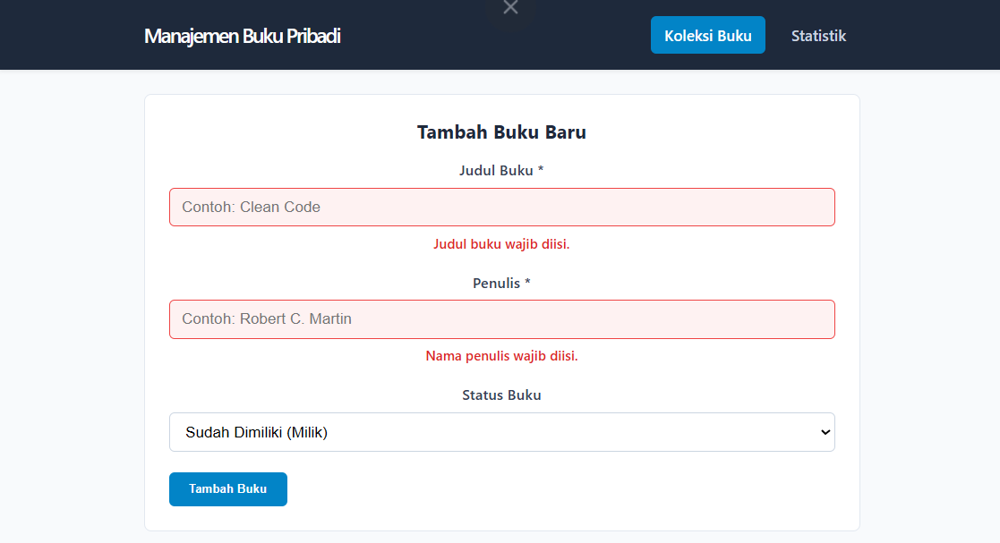
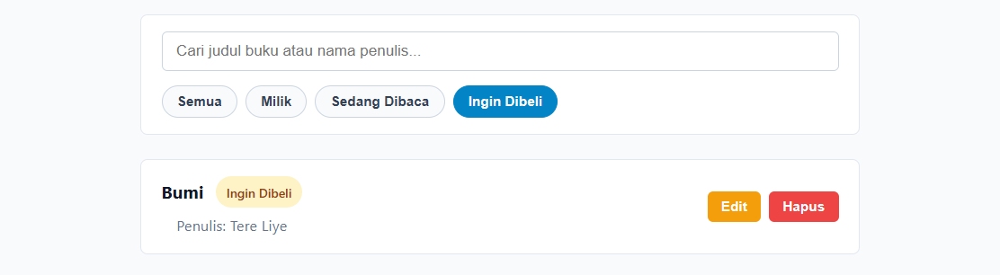
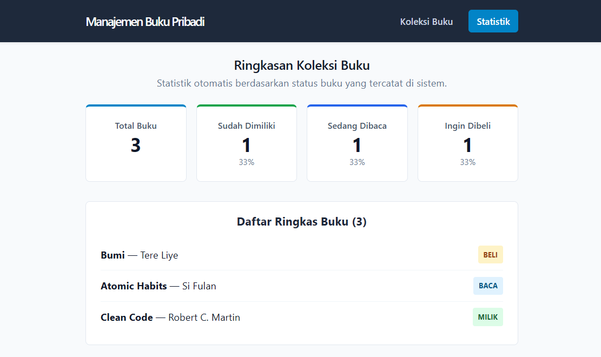
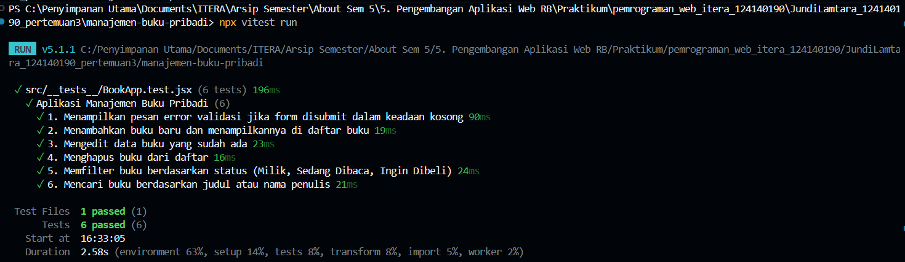

# Aplikasi Manajemen Buku Pribadi

## Identitas

- **Nama Lengkap:** Jundi Lamtara
- **NIM:** 124140190
- **Program Studi:** Teknik Informatika
- **Kelas Praktikum:** Pengembangan Aplikasi Web RB
- **Repository GitHub:** [Source Code Pertemuan 3](https://github.com/Jey-EL/pemrograman_web_itera_124140190/tree/main/JundiLamtara_124140190_pertemuan3)
- **GitHub Pages:** [Aplikasi Manajemen Buku Pribadi](https://jey-el.github.io/pemrograman_web_itera_124140190/pertemuan3/)

## Deskripsi Aplikasi

Aplikasi **Manajemen Buku Pribadi** merupakan aplikasi berbasis web yang dibangun menggunakan **React** dan **Vite** untuk membantu pengguna mencatat, mengelola, menyaring, dan memantau statistik koleksi buku pribadi. Aplikasi ini mendukung pengelompokan buku berdasarkan status kepemilikan dan bacaan (**Sudah Dimiliki**, **Sedang Dibaca**, dan **Ingin Dibeli**), validasi input form dengan umpan balik visual, pencarian dan filter *real-time*, navigasi multi-halaman menggunakan **React Router**, pengelolaan *state* global dengan **Context API**, serta penyimpanan data secara persisten menggunakan `localStorage`.

## Struktur Berkas

```text
JundiLamtara_124140190_pertemuan3/
│
├── konsep-dasar-react/
│ 
├── manajemen-buku-pribadi/
│   │
│   ├── src/
│   │   ├── __tests__/
│   │   │   └── BookApp.test.jsx
│   │   │
│   │   ├── components/
│   │   │   ├── BookFilter/
│   │   │   │   ├── BookFilter.css
│   │   │   │   └── BookFilter.jsx
│   │   │   ├── BookForm/
│   │   │   │   ├── BookForm.css
│   │   │   │   └── BookForm.jsx
│   │   │   └── BookList/
│   │   │       ├── BookList.css
│   │   │       └── BookList.jsx
│   │   │
│   │   ├── context/
│   │   │   └── BookContext.jsx
│   │   │
│   │   ├── hooks/
│   │   │   ├── useBookStats.js
│   │   │   └── useLocalStorage.js
│   │   │
│   │   ├── pages/
│   │   │   ├── Home/
│   │   │   │   ├── Home.css
│   │   │   │   └── Home.jsx
│   │   │   └── Stats/
│   │   │       ├── Stats.css
│   │   │       └── Stats.jsx
│   │   │
│   │   ├── App.css
│   │   ├── App.jsx
│   │   ├── main.jsx
│   │   └── setupTests.js
│   │
│   ├── index.html
│   ├── package.json
│   ├── README.md
│   └── vite.config.js
│ 
├── my-react-app/
│ 
├── screenshots/
│   ├── 01-home-books.png
│   ├── 02-form-validation.png
│   ├── 03-filter-books.png
│   ├── 04-stats-page.png
│   └── 05-vitest-result.png
│ 
└── README.md
```

## Panduan Instalasi dan Cara Menjalankan

1. Clone repository ini ke komputer lokal:
   ```bash
   git clone https://github.com/Jey-EL/pemrograman_web_itera_124140190.git
   ```
2. Masuk ke direktori proyek aplikasi manajemen buku:
   ```bash
   cd JundiLamtara_124140190_pertemuan3/manajemen-buku-pribadi
   ```
3. Pasang seluruh dependensi yang dibutuhkan:
   ```bash
   npm install
   ```
4. Jalankan server pengembangan (*development server*):
   ```bash
   npm run dev
   ```
5. Buka alamat URL lokal yang muncul di terminal (secara bawaan `http://localhost:5173/`) melalui browser.
6. Untuk menjalankan seluruh rangkaian *unit test* di terminal:
   ```bash
   npx vitest run
   ```

## Daftar Fitur

- [x] **Manajemen Data Buku (CRUD):** Menambahkan buku baru (judul, penulis, dan status: `milik`, `baca`, atau `beli`), mengedit data buku yang sudah tersimpan, serta menghapus buku dari koleksi.
- [x] **Validasi Form & Error Handling:** Memeriksa kelengkapan kolom wajib isi (Judul Buku dan Penulis) saat form disubmit, menampilkan pesan kesalahan berwarna merah di bawah kolom terkait, serta memberi indikator garis tepi merah (*visual feedback*) apabila input kosong.
- [x] **Filter Berdasarkan Status:** Menyaring daftar buku secara instan berdasarkan kategori status (`Semua`, `Milik`, `Sedang Dibaca`, dan `Ingin Dibeli`).
- [x] **Pencarian Buku Real-Time:** Mencari buku secara langsung berdasarkan kata kunci judul buku maupun nama penulis (*case-insensitive*).
- [x] **Halaman Statistik Koleksi (`/stats`):** Menampilkan kartu ringkasan total buku, jumlah buku pada masing-masing status beserta persentase distribusinya, serta daftar ringkas seluruh koleksi buku.
- [x] **Penyimpanan Persisten (`localStorage`):** Menyimpan setiap perubahan data buku ke `localStorage` sehingga koleksi tetap terjaga meskipun halaman di-refresh atau browser ditutup.

## Penjelasan Fitur React yang Digunakan

1. **Functional Components & React Hooks (`useState`, `useEffect`, `useMemo`):** Seluruh komponen dibangun menggunakan *functional components*. `useState` mengelola state input form, status filter, kata kunci pencarian, dan buku yang sedang diedit; `useEffect` menyinkronkan data form saat mode edit aktif serta menulis perubahan data ke `localStorage`; sedangkan `useMemo` mengoptimalkan kalkulasi statistik buku.
2. **Komponen Reusable & Modular (`BookForm`, `BookFilter`, `BookList`):** Antarmuka dipecah menjadi 3 komponen mandiri dengan berkas CSS masing-masing sehingga mudah dipelihara, diuji, dan digunakan kembali.
3. **Context API (`BookContext.jsx`):** Menyediakan `BookProvider` dan *custom hook* `useBooks()` untuk mendistribusikan state global koleksi buku beserta fungsi manipulasinya (`addBook`, `updateBook`, `deleteBook`, `filteredBooks`, `stats`) ke seluruh halaman tanpa *prop drilling*.
4. **Custom Hooks (`useLocalStorage.js` & `useBookStats.js`):**
   - `useLocalStorage.js` mengenkapsulasi logika pembacaan (`JSON.parse`) dan penyimpanan (`JSON.stringify`) data ke `window.localStorage`.
   - `useBookStats.js` menghitung total buku serta jumlah buku berstatus `milik`, `baca`, dan `beli` secara otomatis setiap kali daftar buku berubah.
5. **React Router (`react-router-dom`):** Mengatur navigasi multi-halaman berbasis SPA (*Single Page Application*) menggunakan `BrowserRouter`, `Routes`, `Route`, dan `NavLink` untuk berpindah antara halaman **Koleksi Buku (`/`)** dan **Statistik (`/stats`)**.
6. **PropTypes (`prop-types`):** Menerapkan pemeriksaan tipe data (*type checking*) pada seluruh *props* komponen (`BookForm`, `BookFilter`, `BookList`, dan `BookProvider`) untuk menjaga integritas data antar komponen.

## Tangkapan Layar (Screenshot)

### 1. Halaman Utama Koleksi Buku (`/`)


### 2. Validasi Error Form Input Kosong


### 3. Fitur Filter Buku Berdasarkan Status


### 4. Halaman Statistik Koleksi Buku (`/stats`)


## Laporan Unit Testing

Pengujian otomatis dilakukan menggunakan **Vitest** dan **React Testing Library** pada berkas `src/__tests__/BookApp.test.jsx` yang mencakup 6 skenario pengujian utama:
1. Menampilkan pesan error validasi jika form disubmit dalam keadaan kosong.
2. Menambahkan buku baru dan menampilkannya di daftar buku.
3. Mengedit data buku yang sudah ada.
4. Menghapus buku dari daftar.
5. Memfilter buku berdasarkan status (`Milik`, `Sedang Dibaca`, `Ingin Dibeli`).
6. Mencari buku berdasarkan judul atau nama penulis.

