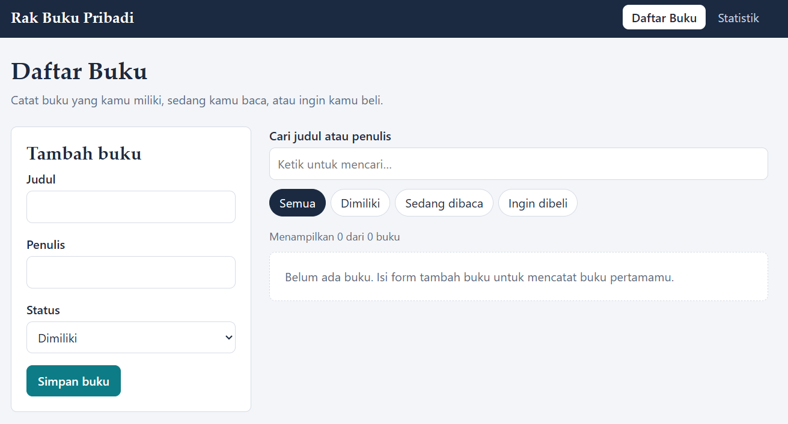
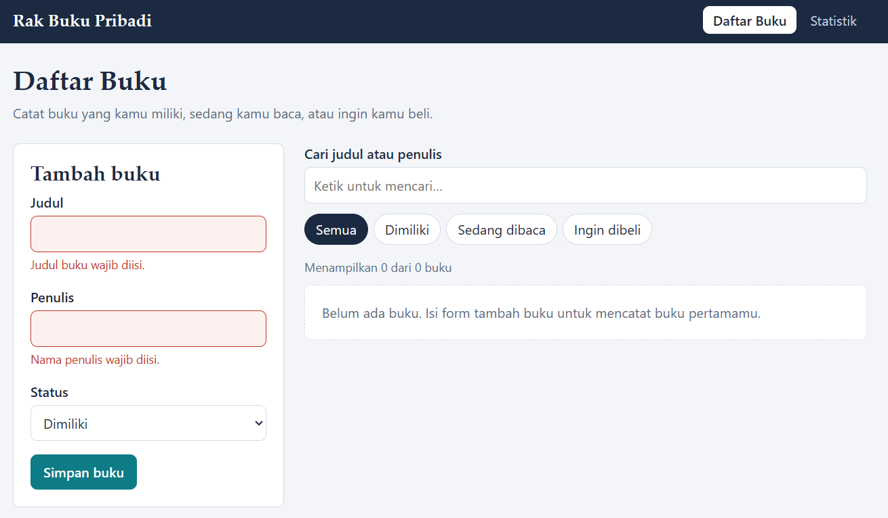
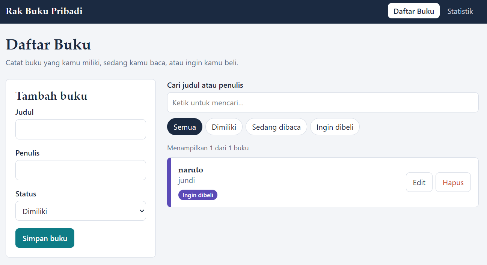
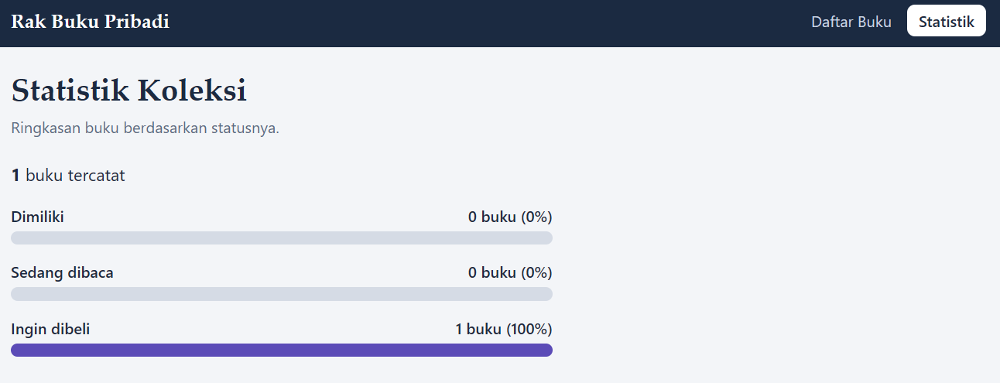
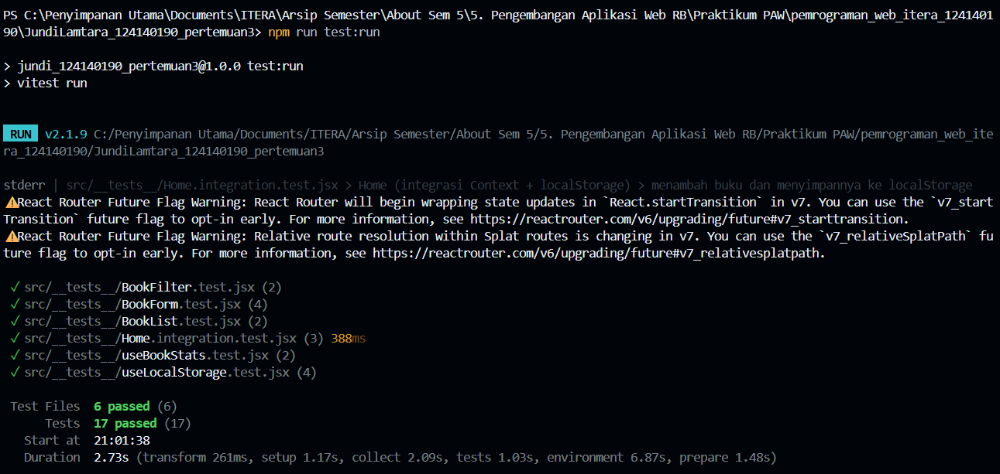

# Rak Buku Pribadi — Aplikasi Manajemen Buku (React)

## Identitas

- **Nama Lengkap:** Jundi Lamtara
- **NIM:** 124140190
- **Program Studi:** Teknik Informatika
- **Kelas Praktikum:** Pengembangan Aplikasi Web RB
- **Repository GitHub:** [Source Code Pertemuan 3](https://github.com/Jey-EL/pemrograman_web_itera_124140190/tree/main/JundiLamtara_124140190_pertemuan3)
- **GitHub Pages:** [Demo Pertemuan 3](https://jey-el.github.io/pemrograman_web_itera_124140190/pertemuan3/)

## Deskripsi Aplikasi

Aplikasi web untuk mencatat buku pribadi. Setiap buku punya **judul**, **penulis**, dan **status**:
**Dimiliki**, **Sedang dibaca**, atau **Ingin dibeli**. Data tersimpan di `localStorage`, jadi tidak hilang saat halaman di-refresh.

Fitur:
- Tambah, edit, dan hapus buku
- Filter berdasarkan status
- Pencarian berdasarkan judul atau nama penulis
- Validasi form (judul & penulis wajib diisi) dengan umpan balik visual
- Halaman statistik jumlah dan persentase buku per status

## Instalasi dan Cara Menjalankan (VS Code)

Prasyarat: [Node.js](https://nodejs.org) versi 18 atau lebih baru.

```bash
# 1. Masuk ke folder project
cd JundiLamtara_124140190_pertemuan3

# 2. Pasang dependensi
npm install

# 3. Jalankan aplikasi (buka alamat yang tampil, biasanya http://localhost:5173)
npm run dev
```

Perintah lain:

```bash
npm run test:run   # jalankan semua unit test sekali
npm test           # unit test mode watch
npm run build      # build produksi ke folder dist/
npm run deploy     # build + publish ke GitHub Pages (branch gh-pages)
```

Folder `node_modules/` dan `dist/` sudah masuk `.gitignore` sehingga tidak ikut ter-upload.

### Cara membuat project dari nol (sesuai soal)

```bash
npm create vite@latest JundiLamtara_124140190_pertemuan3 -- --template react
cd JundiLamtara_124140190_pertemuan3
npm install react-router-dom prop-types
npm install -D vitest @testing-library/react @testing-library/jest-dom jsdom
```

## Screenshot Antarmuka

| Halaman | Screenshot |
|---|---|
| Daftar Buku |  |
| Form validasi error |  |
| Edit buku |  |
| Statistik |  |

## Laporan Testing



Ringkasan 17 test di `src/__tests__/`:

| File | Yang diuji |
|---|---|
| `useLocalStorage.test.jsx` | nilai awal, simpan, baca data lama, JSON rusak (4 test) |
| `useBookStats.test.jsx` | hitung total/persentase, daftar kosong (2 test) |
| `BookForm.test.jsx` | error saat kosong, input spasi, submit ter-trim, mode edit (4 test) |
| `BookFilter.test.jsx` | klik status, ketik pencarian (2 test) |
| `BookList.test.jsx` | pesan kosong, tombol edit/hapus (2 test) |
| `Home.integration.test.jsx` | tambah + localStorage, filter + cari, edit + hapus (3 test) |

## Penjelasan Fitur React yang Digunakan

| Konsep | Lokasi | Keterangan |
|---|---|---|
| `useState` | `BookForm.jsx`, `BookContext.jsx` | state input form, filter, pencarian, buku yang diedit |
| `useEffect` | `hooks/useLocalStorage.js` | menyimpan data ke localStorage setiap berubah |
| `useMemo` / `useCallback` | `BookContext.jsx`, `hooks/useBookStats.js` | hasil filter dan statistik tidak dihitung ulang tanpa perlu |
| Context API | `context/BookContext.jsx` | state buku global + `useBooks()` untuk mengaksesnya |
| React Router | `main.jsx`, `App.jsx`, `Navbar.jsx` | `HashRouter`, `Routes`, `NavLink`; halaman `/` dan `/stats` |
| Custom hook #1 | `hooks/useLocalStorage.js` | state yang persisten di localStorage |
| Custom hook #2 | `hooks/useBookStats.js` | hitung statistik koleksi |
| Komponen reusable | `Navbar`, `BookForm`, `BookFilter`, `BookItem`, `BookList` | masing-masing punya folder + CSS sendiri |
| PropTypes | semua komponen | type checking props |
| Error handling form | `BookForm.jsx` (`validate`) | pesan error, border merah, `aria-invalid`, `role="alert"` |

## Struktur Folder

```
src/
├── components/
│   ├── BookForm/     BookFilter/     BookList/
│   ├── BookItem/     Navbar/
├── pages/
│   ├── Home/         Stats/
├── hooks/            useLocalStorage.js, useBookStats.js
├── context/          BookContext.jsx
├── __tests__/        unit & integration test
├── constants.js
└── App.jsx
```

## Pengumpulan

- Repository: `pemrograman_web_itera_124140190`
- Folder pertemuan: `JundiLamtara_124140190_pertemuan3`
- `node_modules/` tidak di-upload (lihat `.gitignore`)
