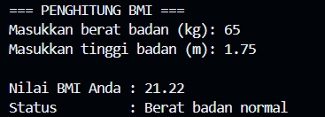
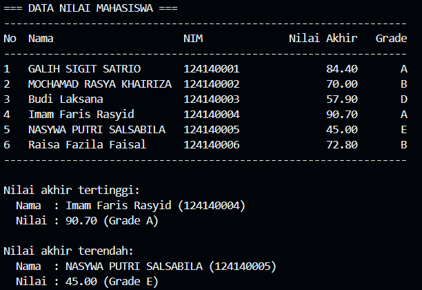
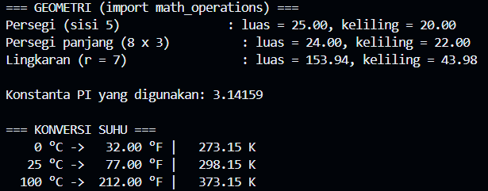

# Tugas Praktikum: Dasar Pemrograman Python

## Identitas

- **Nama Lengkap:** Jundi Lamtara
- **NIM:** 124140190
- **Program Studi:** Teknik Informatika
- **Kelas Praktikum:** Pengembangan Aplikasi Web RB
- **Repository GitHub:** [Source Code Pertemuan 4](https://github.com/Jey-EL/pemrograman_web_itera_124140190/tree/main/JundiLamtara_124140190_pertemuan4)

## Struktur Berkas

```
Jundi_124140190_pertemuan4/
├── .gitignore
├── README.md
├── tugas1_bmi.py
├── tugas2_nilai_mahasiswa.py
├── math_operations.py
└── main.py
```

## Soal 1: Penghitung BMI (`tugas1_bmi.py`)

Program meminta berat badan (kg) dan tinggi badan (m), menghitung BMI dengan rumus `berat / (tinggi * tinggi)`, lalu menentukan kategori dengan `if-elif-else`:

| Nilai BMI        | Kategori             |
|------------------|----------------------|
| < 18.5           | Berat badan kurang   |
| 18.5 – < 25      | Berat badan normal   |
| 25 – < 30        | Berat badan berlebih |
| ≥ 30             | Obesitas             |

**Cara menjalankan:**
```bash
python tugas1_bmi.py
```

**Screenshot hasil eksekusi:** 



## Soal 2: Pengelolaan Nilai Mahasiswa (`tugas2_nilai_mahasiswa.py`)

Program menyimpan data 6 mahasiswa dalam list berisi dictionary. Nilai akhir dihitung dengan bobot `30% UTS + 40% UAS + 30% Tugas`. Grade ditentukan dari A sampai E, kemudian data ditampilkan dalam tabel. Program juga mencari mahasiswa dengan nilai akhir tertinggi dan terendah menggunakan `max()` dan `min()` dengan parameter `key`.

**Cara menjalankan:**
```bash
python tugas2_nilai_mahasiswa.py
```

**Screenshot hasil eksekusi:**



## Soal 3: Modul Matematika (`math_operations.py` & `main.py`)

- `math_operations.py` adalah modul yang berisi konstanta `PI` serta fungsi:
  - Geometri: `luas_persegi`, `keliling_persegi`, `luas_persegi_panjang`, `keliling_persegi_panjang`, `luas_lingkaran`, `keliling_lingkaran`.
  - Konversi suhu: `celsius_ke_fahrenheit`, `celsius_ke_kelvin`.
- `main.py` mengimpor modul dengan dua cara: `import math_operations` dan `from math_operations import PI, luas_lingkaran, celsius_ke_kelvin`.

**Cara menjalankan:**
```bash
python main.py
```
Jalankan dari dalam folder yang sama agar impor modul berhasil.

**Screenshot hasil eksekusi:**


