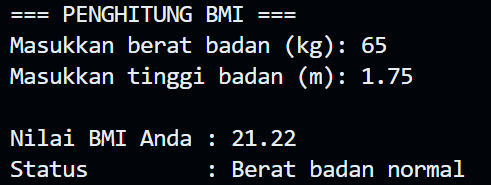
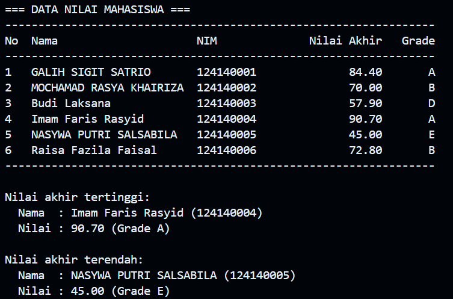
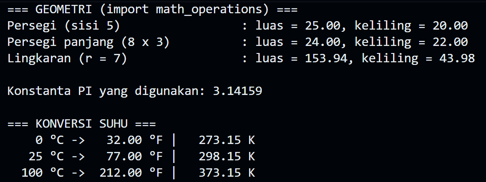

# Dasar Pemrograman Python & Modularitas Program

## Identitas

- **Nama Lengkap:** Jundi Lamtara
- **NIM:** 124140190
- **Program Studi:** Teknik Informatika
- **Kelas Praktikum:** Pengembangan Aplikasi Web RB
- **Repository GitHub:** [Source Code Pertemuan 4](https://github.com/Jey-EL/pemrograman_web_itera_124140190/tree/main/JundiLamtara_124140190_pertemuan4)

## Deskripsi Program

Program ini merupakan kumpulan aplikasi konsol berbasis Python yang mengimplementasikan dasar-dasar pemrograman prosedural, struktur kendali, koleksi data, dan modularitas fungsi. Pada folder tugas utama (`tugas_dasar_python`), terdapat tiga program mandiri yang meliputi **Program Penghitung BMI (`tugas1_bmi.py`)**, **Program Pengelolaan Data Nilai Mahasiswa (`tugas2_nilai_mahasiswa.py`)**, serta **Modul Matematika & Program Pengujian (`math_operations.py` & `main.py`)** yang disusun sesuai standar penulisan PEP 8.

## Struktur Berkas

```text
JundiLamtara_124140190_pertemuan4/
│
├── hands-on/
│   ├── 01_pengenalan.py
│   ├── 02_variabel.py
│   ├── 03_kendali.py
│   ├── 04_fungsi.py
│   ├── 05_struktur_data.py
│   ├── 06_modul_app.py
│   └── kalkulator_lib.py
│
├── latihan/
│   ├── latihan1.py
│   ├── latihan2_suhu.py
│   ├── latihan3_tebak.py
│   ├── latihan4_validasi.py
│   ├── latihan5_kontak.py
│   ├── main.py
│   └── password_gen.py
│
├── screenshot/
│   ├── 01_penghitung-bmi.png
│   ├── 02_nilai-mahasiswa.png
│   └── 03_math_operations.png
│
├── tugas_dasar_python/
│   ├── .gitignore
│   ├── main.py
│   ├── math_operations.py
│   ├── tugas1_bmi.py
│   └── tugas2_nilai_mahasiswa.py
│
└── README.md
```

## Panduan Menjalankan Program

1. Pastikan **Python 3.8+** sudah terpasang pada sistem Anda (verifikasi dengan `python --version`).
2. Clone atau unduh repository ini ke komputer lokal:
   ```bash
   git clone https://github.com/Jey-EL/pemrograman_web_itera_124140190.git
   ```
3. Buka folder `JundiLamtara_124140190_pertemuan4` di **Visual Studio Code**, lalu buka integrated terminal (`Ctrl + \``).
4. Masuk ke direktori `tugas_dasar_python`:
   ```bash
   cd JundiLamtara_124140190_pertemuan4/tugas_dasar_python
   ```
5. Jalankan masing-masing skrip tugas melalui terminal:
   - **Soal 1 — Program Penghitung BMI:**
     ```bash
     python tugas1_bmi.py
     ```
   - **Soal 2 — Program Pengelolaan Data Nilai Mahasiswa:**
     ```bash
     python tugas2_nilai_mahasiswa.py
     ```
   - **Soal 3 — Modul Matematika & Program Pengujian:**
     ```bash
     python main.py
     ```
6. *(Opsional)* Untuk menjalankan skrip percobaan pada folder `hands-on` atau `latihan`, arahkan terminal ke folder terkait lalu eksekusi berkas `.py` yang diinginkan:
   ```bash
   # Contoh menjalankan hands-on
   cd ../hands-on
   python 06_modul_app.py

   # Contoh menjalankan latihan mandiri
   cd ../latihan
   python main.py
   ```

## Daftar Fitur

- [x] **Penghitung BMI Interaktif (`tugas1_bmi.py`):** Menerima input berat badan (kg) dan tinggi badan (m), menghitung $\text{BMI} = \frac{\text{berat}}{\text{tinggi}^2}$, memformat hasil ke 2 angka di belakang koma dengan *f-string*, serta mengklasifikasikan status berat badan (`Berat badan kurang`, `Berat badan normal`, `Berat badan berlebih`, dan `Obesitas`).
- [x] **Rekapitulasi & Statistik Nilai Mahasiswa (`tugas2_nilai_mahasiswa.py`):** Menyimpan data mahasiswa dalam `list` of `dictionary`, menghitung nilai akhir dengan bobot `30% UTS + 40% UAS + 30% Tugas`, mengonversi nilai ke grade `A`–`E`, mencetak tabel berformat dinamis ke terminal, serta menampilkan mahasiswa peraih nilai tertinggi dan terendah.
- [x] **Modul Matematika Kustom (`math_operations.py`):** Menyediakan konstanta `PI = 3.14159`, fungsi luas dan keliling untuk 3 bangun datar (persegi, persegi panjang, dan lingkaran), serta 2 fungsi konversi temperatur suhu (Celsius ke Fahrenheit dan Celsius ke Kelvin).
- [x] **Pengujian Modul Multi-Impor (`main.py`):** Mengimpor dan menguji seluruh fungsi dari `math_operations.py` dengan menerapkan dua gaya impor berbeda (`import math_operations as ...` dan `from math_operations import ...`).
- [x] **Konvensi PEP 8 & Dokumentasi Fungsi:** Seluruh berkas menggunakan indentasi 4 spasi, penamaan variabel/fungsi `snake_case`, *type hints*, serta *docstring* pada setiap fungsi untuk menjelaskan parameter dan nilai kembaliannya.
- [x] **Konfigurasi `.gitignore`:** Mengabaikan direktori `venv/`, `__pycache__/`, dan berkas sementara agar tidak ikut terunggah ke repositori Git.

## Penjelasan Teknis Singkat

1. **Alur Kerja `tugas1_bmi.py`:** Input berat badan dan tinggi badan dibaca sebagai tipe `float` melalui `input()`, lalu diproses oleh fungsi `hitung_bmi(berat, tinggi)`. Nilai BMI yang dikembalikan selanjutnya dievaluasi menggunakan percabangan berjenjang `if-elif-else` di dalam fungsi `tentukan_kategori_bmi(bmi)` untuk menentukan kategori status berat badan dan mencetaknya ke terminal.
2. **Alur Kerja `tugas2_nilai_mahasiswa.py`:** Setiap dictionary mahasiswa di dalam `data_mahasiswa` diiterasi menggunakan perulangan `for` untuk menghitung `nilai_akhir` (via `hitung_nilai_akhir()`) dan menentukan `grade` (via `tentukan_grade()`). Lebar kolom tabel dihitung secara dinamis berdasarkan panjang nama terpanjang sebelum dicetak dengan perataan *f-string*. Fungsi bawaan `max()` dan `min()` dengan `key=lambda m: m["nilai_akhir"]` digunakan untuk mengidentifikasi peraih nilai tertinggi dan terendah.
3. **Alur Kerja `math_operations.py` & `main.py`:** Seluruh fungsi geometri dan konversi suhu dienkapsulasi secara modular di `math_operations.py` bersama konstanta `PI`. Berkas `main.py` mengimpor modul tersebut menggunakan dua pendekatan berbeda (impor modul dengan alias dan impor selektif ke *namespace* lokal) untuk mengeksekusi dan menampilkan hasil pengujian seluruh fungsi secara terstruktur.

## Tangkapan Layar (Screenshot)

### 1. Hasil Eksekusi Program Penghitung BMI (`tugas1_bmi.py`)


### 2. Hasil Eksekusi Pengelolaan Data Nilai Mahasiswa (`tugas2_nilai_mahasiswa.py`)


### 3. Hasil Eksekusi Modul Matematika Python (`main.py`)
