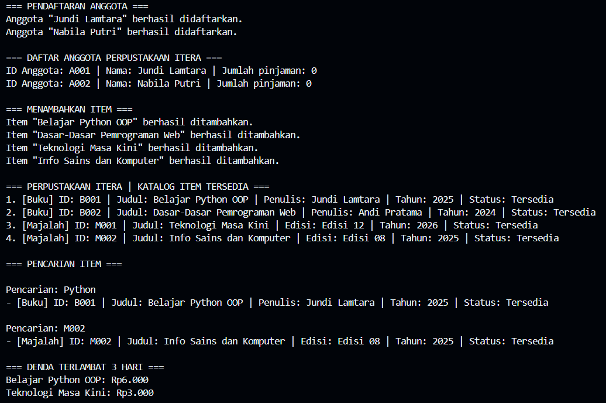
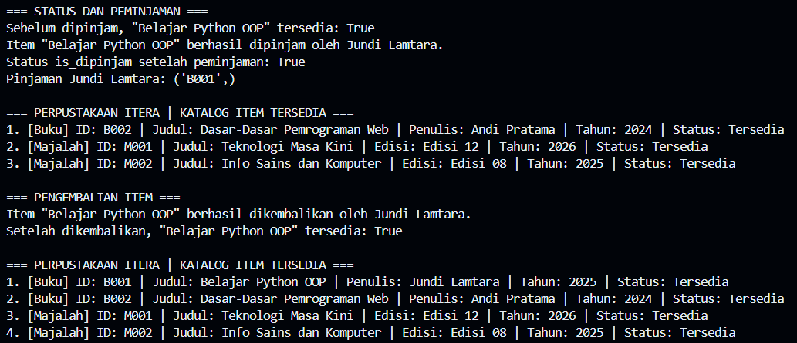

# Sistem Manajemen Perpustakaan Sederhana

## Identitas

- **Nama Lengkap:** Jundi Lamtara
- **NIM:** 124140190
- **Program Studi:** Teknik Informatika
- **Kelas Praktikum:** Pengembangan Aplikasi Web RB
- **Repository GitHub:** [Source Code Pertemuan 5](https://github.com/Jey-EL/pemrograman_web_itera_124140190/tree/main/JundiLamtara_124140190_pertemuan5)

## Deskripsi Program

Program ini merupakan sistem manajemen perpustakaan sederhana menggunakan Python dan konsep Object-Oriented Programming (OOP). Program dapat mendaftarkan anggota, menambahkan buku dan majalah, menampilkan katalog item yang tersedia, mencari item berdasarkan judul atau ID, serta memproses peminjaman dan pengembalian.

## Penerapan Konsep OOP

1. **Class:** `LibraryItem`, `Book`, `Magazine`, `Member`, dan `Library` menjadi cetak biru objek dalam program.
2. **Inheritance:** `Book` dan `Magazine` mewarisi `LibraryItem` serta mengimplementasikan method abstrak `get_detail()` dan `hitung_denda()`.
3. **Encapsulation:** `Library` menyimpan koleksi item dan anggota pada atribut private `__koleksi` dan `__anggota`. `LibraryItem` menyimpan status peminjaman pada `__dipinjam`. `Member` menyimpan identitas dan daftar pinjaman pada atribut private. Data diakses melalui property atau method yang disediakan.
4. **Polymorphism:** `Book` dan `Magazine` memiliki implementasi `get_detail()` dan `hitung_denda()` yang berbeda. Pemanggil cukup menggunakan nama method yang sama tanpa perlu mengetahui jenis item secara langsung.

## Struktur Berkas

```text
JundiLamtara_124140190_pertemuan5/
│
├── hands-on/
│   ├── 01_everything_is_object.py
│   ├── 01_procedural_vs_oop.py
│   ├── 02_class_object.py
│   ├── 03_inheritance.py
│   ├── 04_encapsulation.py
│   ├── 05_polymorphism.py
│   └── 06_abstract_class.py
│ 
├── latihan/
│   ├── latihan1_kasir.py
│   ├── latihan2_buku.py
│   ├── latihan3_truk.py
│   ├── latihan4_karyawan.py
│   ├── latihan5_notifikasi.py
│   └── latihan6_storage.py
│
├── screenshot/
│   ├── output-program-1.png
│   └── output-program-2.png
│
├── tugas_perpustakaan/
│   ├── library_item.py
│   ├── member.py
│   ├── library.py
│   └── main.py
│
├── README.md
└── .gitignore
```

## Panduan Menjalankan Program

1. Pastikan Python sudah terpasang.
2. Buka terminal pada folder `tugas_perpustakaan`.
3. Jalankan perintah berikut:

```bash
python main.py
```

Pada Windows, perintah `py main.py` juga dapat digunakan.

## Fitur Program

- Mendaftarkan anggota perpustakaan.
- Menambahkan buku dan majalah ke koleksi.
- Menampilkan katalog item yang tersedia.
- Mencari item berdasarkan ID atau sebagian judul.
- Meminjam dan mengembalikan item serta memperbarui status ketersediaannya.
- Mencatat item yang sedang dipinjam oleh anggota.
- Menghitung denda dengan tarif berbeda berdasarkan jenis item.

## Screenshot Output

### 1. Penambahan Item, Katalog, Pencarian, dan Denda



### 2. Status dan Peminjaman



## Catatan

Program ini menggunakan dictionary sebagai penyimpanan sementara di memori. Data anggota dan koleksi akan hilang ketika program dihentikan. Simulasi ini belum menggunakan database.