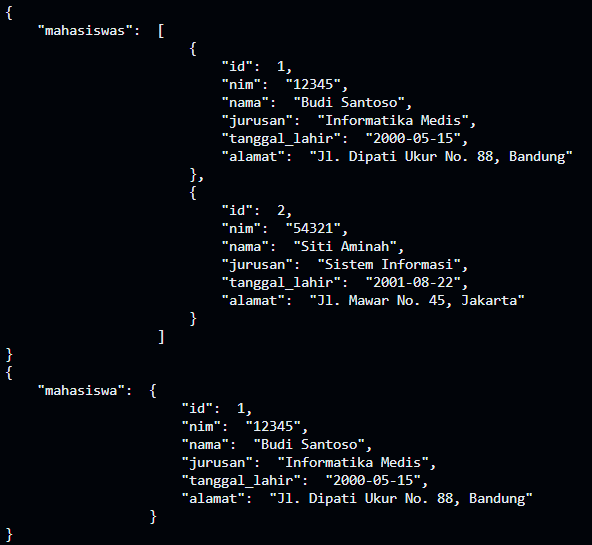
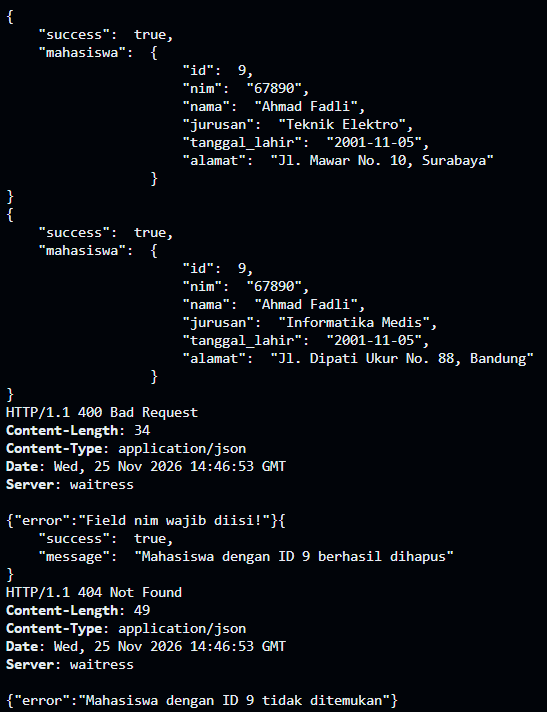
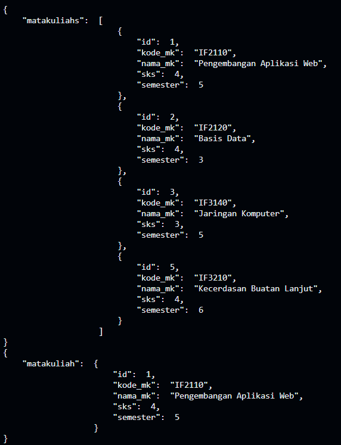
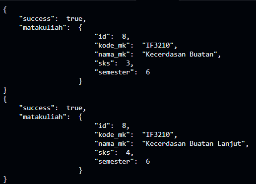
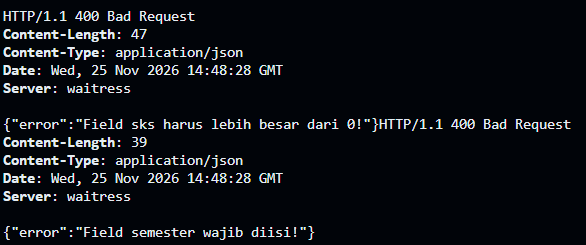
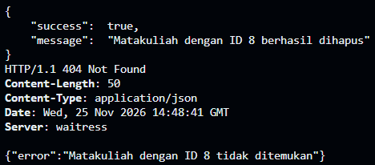

# Aplikasi RESTful API Manajemen Mahasiswa & Matakuliah

## Identitas

- **Nama Lengkap:** Jundi Lamtara
- **NIM:** 124140190
- **Program Studi:** Teknik Informatika
- **Kelas Praktikum:** Pengembangan Aplikasi Web RB
- **Repository GitHub:** [Source Code Pertemuan 6](https://github.com/Jey-EL/pemrograman_web_itera_124140190/tree/main/JundiLamtara_124140190_pertemuan6)

## Deskripsi Aplikasi

Aplikasi **RESTful API Manajemen Mahasiswa & Matakuliah** merupakan layanan *backend* berbasis **Python Pyramid Framework** dan **PostgreSQL** yang mengimplementasikan arsitektur berlapis (*Model–View–Route*) untuk mengelola data akademik mahasiswa dan mata kuliah. Aplikasi ini mendukung operasi **CRUD** (*Create, Read, Update, Delete*) secara penuh melalui pertukaran data berformat **JSON**, pemetaan objek-relasional menggunakan **SQLAlchemy ORM**, pelacakan versi skema basis data menggunakan **Alembic**, inisialisasi data awal (*database seeding*), serta validasi payload dan penanganan kode status HTTP (`200 OK`, `400 Bad Request`, dan `404 Not Found`).

## Struktur Berkas

```text
JundiLamtara_124140190_pertemuan6/
│
├── pyramid_mahasiswa/
│   ├── alembic/
│   │   ├── env.py
│   │   └── versions/
│   │       ├── *_create_mahasiswa_table.py
│   │       └── *_create_matakuliah_table.py
│   │
│   ├── models/
│   │   ├── __init__.py
│   │   ├── meta.py
│   │   ├── mahasiswa.py
│   │   └── matakuliah.py
│   │
│   ├── scripts/
│   │   ├── __init__.py
│   │   └── initialize_db.py
│   │
│   ├── static/
│   ├── templates/
│   │
│   ├── views/
│   │   ├── __init__.py
│   │   ├── default.py
│   │   ├── mahasiswa.py
│   │   ├── matakuliah.py
│   │   └── notfound.py
│   │
│   ├── __init__.py
│   ├── pshell.py
│   ├── routes.py
│   └── tests.py
│
├── screenshots/
│   ├── 01-mahasiswa-get-all.png
│   ├── 02-mahasiswa-crud.png
│   ├── 03-matakuliah-get-all.png
│   ├── 04-matakuliah-post-put.png
│   ├── 05-matakuliah-validation-400.png
│   └── 06-matakuliah-delete-404.png
│
├── .coveragerc
├── .gitignore
├── CHANGES.txt
├── development.ini
├── MANIFEST.in
├── production.ini
├── pytest.ini
├── README.md
├── README.txt
└── setup.py
```

## Panduan Instalasi dan Cara Menjalankan

1. Clone repository ini ke komputer lokal:
   ```bash
   git clone https://github.com/Jey-EL/pemrograman_web_itera_124140190.git
   ```
2. Masuk ke direktori root proyek yang sejajar dengan `development.ini` dan `setup.py`:
   ```powershell
   cd JundiLamtara_124140190_pertemuan6
   ```
3. Buat dan aktifkan *virtual environment* Python (disarankan berada di path pendek seperti `C:\venv_pyramid` pada Windows untuk menghindari batas `MAX_PATH`):
   ```powershell
   python -m venv C:\venv_pyramid
   C:\venv_pyramid\Scripts\Activate.ps1
   ```
4. Pasang paket proyek beserta seluruh dependensinya (*editable install*):
   ```powershell
   pip install -e .
   ```
5. Pastikan layanan **PostgreSQL** sudah berjalan serta database `pyramid_mahasiswa` dan user `pyramid_user` telah dikonfigurasi sesuai parameter `sqlalchemy.url` pada berkas `development.ini`.
6. Jalankan migrasi skema tabel ke PostgreSQL menggunakan **Alembic**:
   ```powershell
   alembic -c development.ini upgrade head
   ```
7. Isi data awal (*database seeding*) untuk tabel `mahasiswa` dan `matakuliah`:
   ```powershell
   initialize_pyramid_mahasiswa_db development.ini
   ```
8. Jalankan server pengembangan **Waitress** bawaan Pyramid:
   ```powershell
   pserve development.ini --reload
   ```
9. Server akan berjalan secara bawaan pada alamat `http://localhost:6543`.

## Daftar Fitur

- [x] **Manajemen Data Mahasiswa (CRUD):** Mengambil seluruh daftar mahasiswa (`GET /api/mahasiswa`), mengambil detail mahasiswa berdasarkan ID (`GET /api/mahasiswa/{id}`), menambah data baru (`POST /api/mahasiswa`), memperbarui data (`PUT /api/mahasiswa/{id}`), dan menghapus data (`DELETE /api/mahasiswa/{id}`).
- [x] **Manajemen Data Matakuliah (CRUD):** Mengambil seluruh daftar mata kuliah (`GET /api/matakuliah`), mengambil detail mata kuliah berdasarkan ID (`GET /api/matakuliah/{id}`), menambah mata kuliah baru (`POST /api/matakuliah`), memperbarui data mata kuliah (`PUT /api/matakuliah/{id}`), dan menghapus mata kuliah (`DELETE /api/matakuliah/{id}`).
- [x] **Validasi Input & Error Handling HTTP:** Memvalidasi kelengkapan atribut wajib (`nim`, `nama`, `jurusan` untuk Mahasiswa; `kode_mk`, `nama_mk`, `sks`, `semester` untuk Matakuliah), memastikan `sks` dan `semester` bernilai bilangan bulat positif (`> 0`), mencegah duplikasi `kode_mk`, serta mengembalikan respons JSON terstruktur dengan kode `400 Bad Request` atau `404 Not Found`.
- [x] **Migrasi Database Terversi (Alembic):** Mengelola pembuatan dan pembaruan skema tabel `mahasiswa` dan `matakuliah` di PostgreSQL secara terstruktur melalui skrip revisi Alembic.
- [x] **Inisialisasi Data Awal (*Seeding*):** Menyediakan skrip `scripts/initialize_db.py` untuk mengisi data contoh awal secara aman tanpa duplikasi saat dijalankan ulang.

## Spesifikasi Endpoint RESTful API

### 1. Endpoint Mahasiswa (`/api/mahasiswa`)

| HTTP Method | Endpoint | Deskripsi | Status Code |
| :--- | :--- | :--- | :--- |
| `GET` | `/api/mahasiswa` | Mengambil seluruh daftar mahasiswa | `200 OK` |
| `GET` | `/api/mahasiswa/{id}` | Mengambil detail mahasiswa berdasarkan ID | `200 OK` / `404 Not Found` |
| `POST` | `/api/mahasiswa` | Menambahkan data mahasiswa baru | `200 OK` / `400 Bad Request` |
| `PUT` | `/api/mahasiswa/{id}` | Memperbarui data mahasiswa berdasarkan ID | `200 OK` / `400 Bad Request` / `404 Not Found` |
| `DELETE` | `/api/mahasiswa/{id}` | Menghapus data mahasiswa berdasarkan ID | `200 OK` / `404 Not Found` |

### 2. Endpoint Matakuliah (`/api/matakuliah`)

| HTTP Method | Endpoint | Deskripsi | Status Code |
| :--- | :--- | :--- | :--- |
| `GET` | `/api/matakuliah` | Mengambil seluruh daftar mata kuliah | `200 OK` |
| `GET` | `/api/matakuliah/{id}` | Mengambil detail mata kuliah berdasarkan ID | `200 OK` / `404 Not Found` |
| `POST` | `/api/matakuliah` | Menambahkan data mata kuliah baru | `200 OK` / `400 Bad Request` |
| `PUT` | `/api/matakuliah/{id}` | Memperbarui data mata kuliah berdasarkan ID | `200 OK` / `400 Bad Request` / `404 Not Found` |
| `DELETE` | `/api/matakuliah/{id}` | Menghapus data mata kuliah berdasarkan ID | `200 OK` / `404 Not Found` |

## Tangkapan Layar (Screenshot)

### 1. Pengujian Endpoint Mahasiswa (`GET`, `POST`, `PUT`, `DELETE`, `400`, `404`)



### 2. Pengujian Endpoint Matakuliah (`GET All` & `GET Detail`)


### 3. Pengujian Tambah & Ubah Data Matakuliah (`POST` & `PUT`)


### 4. Pengujian Validasi Error `400 Bad Request` Matakuliah


### 5. Pengujian Hapus Data (`DELETE`) & Respons `404 Not Found`

